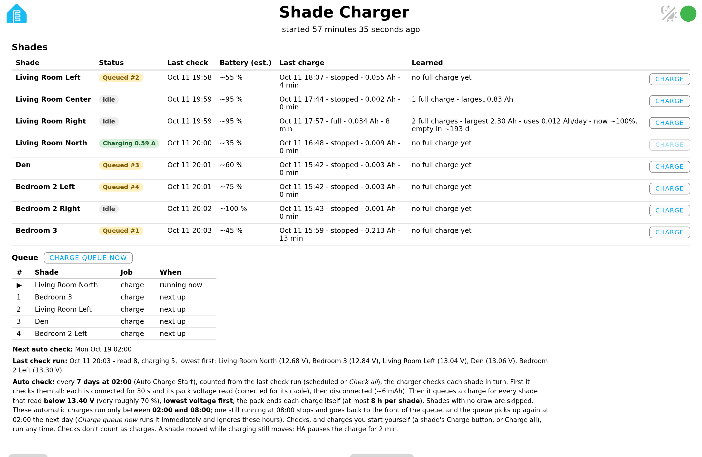
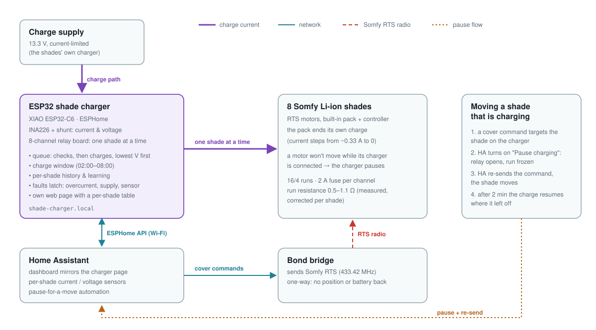
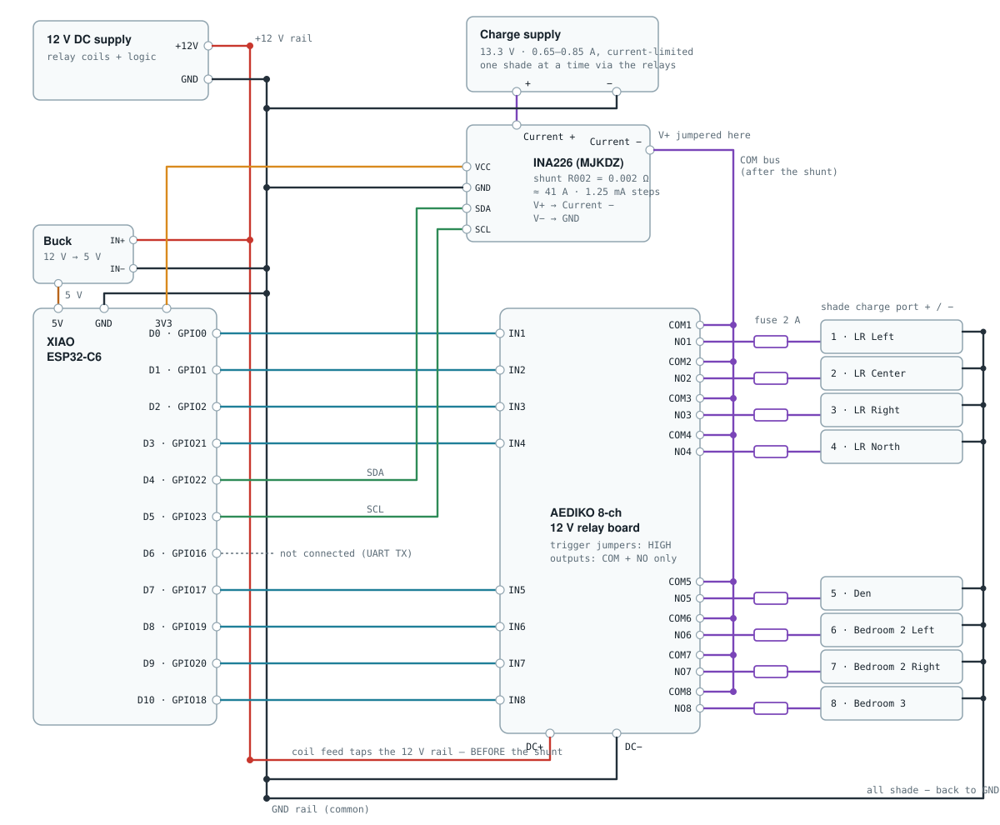
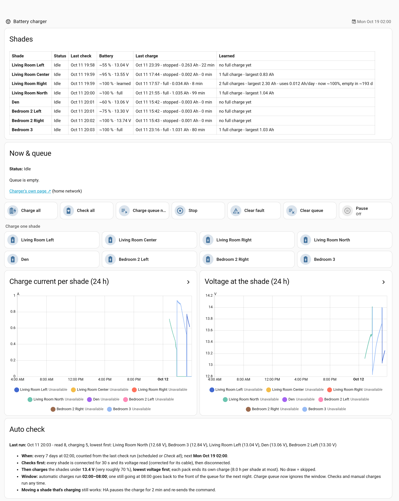

# Somfy shade charger (ESP32)

An ESPHome charger for **battery-powered Somfy RTS shades**. One ESP32 and an
8-channel relay board connect the shades' own charger to **one shade at a time**,
measure every charge with an INA226, and decide by themselves which shade needs
charging and when. It works on its own through a built-in web page, and shows up
in **Home Assistant** with a matching dashboard.

Somfy RTS is one-way radio: a shade never reports its battery. This gives you a
voltage reading per shade, an estimated battery %, a record of every charge, and
charging that happens overnight without anyone plugging cables in.



## What it does

- **Charges 8 shades from one charger**, one at a time, through relays. Each run
  goes to the charger, then the relay of the shade being charged, then its fuse.
- **Check, then charge the emptiest first.** Every shade is connected for 30 s and
  its voltage read (corrected for that shade's cable); shades under a threshold are
  charged, **lowest voltage first**. Weekly on a schedule, or any time with
  **Charge Now**.
- **Charge window.** Automatic charges run between two hours (default 02:00–08:00).
  A charge still running at the end stops and resumes the next night. *Charge Now*
  and a shade's own Charge button ignore the window.
- **Knows when a pack is full, or when it isn't.** The pack ends its own charge:
  the current steps to 0 near the top (seen from 0.31–0.52 A). It counts as
  **full** when that happens at ≥ 13.4 V at the shade, after the current has already
  tapered below 80 % of its peak. Vanishing at full charge current, or at a low
  voltage, is a blown fuse or loose plug (**DROPPED OUT**). A taper that stops moving
  is a cable too long to finish (**full (cable-limited)**), and a pack that never
  stops hits the **time cap**.
- **Safety faults latch** until cleared, and name the shade: overcurrent, current
  sensor failure, a relay watchdog, and the supply voltage being out of range.
- **Per-shade history and learning:** the last 8 charges, the largest charge (a
  capacity floor), Ah used per day, an estimated charge level, and a voltage→Ah fit
  once there are enough charges.
- **Stop holds, it doesn't clear.** *Stop* ends the running job, puts it back at the
  front of the queue and holds the queue; *Charge Now* (or a shade's Charge button)
  resumes it. *Clear queue* empties it.
- **Shades still move while charging.** A Somfy motor ignores commands while its
  charger is connected. A Home Assistant automation pauses the charger and re-sends
  the command, and the charge resumes 2 minutes later.



## Hardware

| Part | Notes |
|---|---|
| Seeed **XIAO ESP32-C6** | ESP-IDF build. GPIO3/GPIO14 drive its RF switch (built-in antenna) and are held low at boot. |
| **8-channel 12 V relay board** (AEDIKO, optocoupled) | Trigger jumpers set to **HIGH**, so a booting/crashed ESP leaves every relay open. COM + NO contacts only. |
| **INA226** module (MJKDZ) with an **R002** (2 mΩ) shunt | High side, between the charger's + and the relays' bussed COMs. ~41 A full scale, 1.25 mA steps. |
| **Charge supply**: the shades' own charger | 13.3 V, current-limited. The two measured: a 0.65 A unit gave ~0.74 A, a 0.85 A one ~0.98 A. |
| **12 V supply** + **5 V buck** | Relay coils and the ESP32. Tap the coil feed **before** the shunt. |
| **2 A fuse per channel**, inline | 1 A fuses at ~1 A ran hot and added ~0.25 Ω. |
| 16/4 cable to the shades | One pair per shade. |



**Pins:** relays IN1–IN8 = D0 D1 D2 D3 D7 D8 D9 D10 (GPIO 0 1 2 21 17 19 20 18);
INA226 SDA/SCL = D4/D5 (GPIO 22/23). D6 (GPIO16) is left free: it is UART TX and
chatters at boot.

**Power the ESP32 and relay coils from their own 12 V supply.** Running them from
the charge supply works on the bench, but the charger's output dips can reset the
ESP32 mid-charge. *Last restart reason* on the page tells a brownout from a crash.

## What the Somfy packs actually do (measured)

- **The charger sets the current; the pack only decides when to stop.** In bulk
  the pack takes whatever the charger can give, and its controller cuts off at
  ~0.31–0.35 A on a 0.74 A charger, ~0.52 A on a 0.98 A one. A full pack still
  takes a short top-up (~0.03 Ah) whenever it is reconnected.
- **Cable resistance matters, but less than you'd think.** Runs measured 0.5–1.1 Ω
  out and back (fuse, relay, cable, joints). Because the pack's cutoff is a current,
  a 1.1 Ω run still finished "full". The thin factory charge lead (~22–24 AWG) cost
  0.44 Ω per 10 ft, so cut it short and splice in 16 AWG.
- One pack took 2.3 Ah from ~12.3 V in 3½ h at 0.74 A.

Each shade has a **Cable resistance** setting (Ω), so its start voltage is read at
the shade, not at the board. Measure it once while charging:
`(charger "Charge voltage" − meter at the shade) / "Charge current"`.

## Battery % estimate

The table's *Battery (est.)* maps a shade's start voltage (30 s into a charge or
check, cable-corrected) onto a curve built from the first packs measured:

| V at shade | ~% |
|---|---|
| 12.10 | 0 |
| 12.26 | 9 |
| 13.20 | 67 |
| 13.60 | 100 |

It updates **live while a shade charges** (from the voltage at the shade now), shows
**100 %** after a full charge, keeps the **end voltage** of a charge that stopped
early, and switches to the shade's learned "now ~%" once it has a use-per-day. The
column shows what each figure is based on, e.g. `~55 % · 13.04 V`, `~100 % · full`, `~95 % · estimated`.

It's rough. It assumes ~2.5 Ah packs, and the voltage also depends on the charge
current (a full pack draws little, so it reads lower). A full charge from low gives
a whole curve: integrate the current for Ah delivered, and pair it with the
cable-corrected voltage during the bulk stage. The curve is the `SOC` table in
`esphome/shade-charger-table.js`, and the copy in the dashboard section.

## Home Assistant

The ESPHome integration picks the device up. `home-assistant/` has the rest:

- **`templates.yaml`**: per-shade current and voltage-at-the-shade sensors. They copy
  the single reading into whichever shade is connected, giving one graph line per
  shade.
- **`automation-pause-for-move.yaml`**: pauses the charger and re-sends a cover
  command aimed at the shade being charged. Map the shade names to your cover
  entities in `covers_by_shade`. A stop is never re-sent, because on a stopped
  Somfy shade it means "go to My".
- **`dashboard-section.yaml`**: a sections-view section that mirrors the charger
  page (shade table, now & queue, controls, per-shade graphs, auto-check summary).



## Setup

1. Wire as above. Set each relay's trigger jumper to HIGH. Check every channel's
   polarity with a meter before plugging in a shade.
2. Copy `esphome/secrets.example.yaml` to `esphome/secrets.yaml` and fill it in.
3. In `esphome/shade-charger.yaml`, set the eight `shadeN` names and `timezone`
   (substitutions at the top).
4. Build and flash: `esphome run shade-charger.yaml`, the first time over USB, then
   over Wi-Fi.
5. On the page: assign each **Relay N shade**, measure each **Cable resistance**,
   then press **Charge Now**.

Flash only when the charger is idle: a reboot opens every relay. The queue survives
a reboot; a charge in progress does not.

## Settings

All on the charger's page ([full-page screenshot](docs/img/charger-page-full.png))
and as ESPHome entities in Home Assistant.


| Setting | Default | |
|---|---|---|
| Auto check every | 7 days | 0 = off. Counted from the last check run (scheduled or *Charge Now*). |
| Auto Charge Start / Stop | 02 / 08 h | Check time and charge window. Equal = no window. |
| Charge below | 13.40 V | A checked shade under this gets charged. |
| Max hours per shade | 8 h | |
| Overcurrent | 1.2 A | About 20 % over the charger's real output. |
| Pause minutes | 2 | How long a pause for a shade move lasts. |
| Supply min / max | 12.5 / 14.5 V | Checked with every relay open, before each shade. |
| Cable resistance *shade* | 0 Ω | Per shade; see above. |
| Relay N shade | 1:1 | Which shade is on which relay. History follows the shade. |

## Files

```
esphome/shade-charger.yaml        the firmware (ESPHome)
esphome/shade-charger-table.js    the web page's shade + queue tables (js_include)
esphome/secrets.example.yaml      secrets template
home-assistant/                   template sensors, pause automation, dashboard section
docs/                             wiring + overview diagrams, screenshots
```

## License

Apache 2.0, see [LICENSE](LICENSE).
